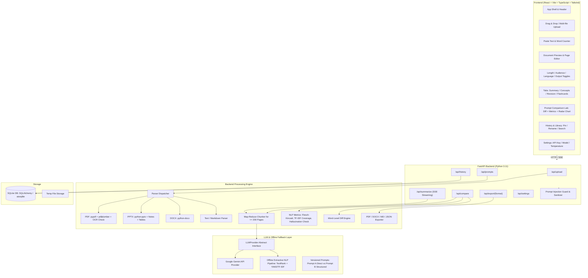

# NoteNest — AI Lecture Notes Summarizer: Project Plan & Architecture

## 1. Executive Summary & Architecture Overview

NoteNest is a production-grade, full-stack web application designed for students, researchers, and educators. It transforms raw lecture materials (PDF, PPT/PPTX, TXT, MD, DOCX, or pasted text) into rich, actionable study assets:
1. Executive summaries (Short vs. Detailed mode with custom length controls)
2. Key Concepts (term, definition, importance, and source page/slide citations)
3. Revision Points (exam-ready bullet points grouped by topic, paired with "likely exam question" hints)
4. Flashcards (interactive flip cards for spaced repetition)
5. **Prompt Comparison Lab (Centerpiece)**: A side-by-side laboratory that executes two divergent prompt architectures (Prompt A: Direct Zero-Shot vs. Prompt B: Structured CoT / Role-scaffolded Few-Shot) on the same input in parallel. It computes objective NLP metrics (Flesch-Kincaid readability, concept coverage %, redundancy, hallucination/grounding checks, latency, compression ratio), renders comparative Recharts (radar + bar), supports human voting, and provides an in-app Prompt Editor.

### System Architecture Diagram

---

## 2. Technical Stack & Design Choices

| Layer | Technology | Rationale |
|---|---|---|
| **Backend Framework** | FastAPI (Python 3.11), Uvicorn | Async performance, native OpenAPI documentation (`/docs`), Pydantic v2 validation, SSE streaming. |
| **Document Parsers** | `pdfplumber`, `pypdf`, `python-pptx`, `python-docx` | Robust extraction of slide text, speaker notes, table cells, and page markers. OCR fallback detector for scanned PDFs. |
| **LLM Provider** | Google Gemini API (`google-genai` / REST) behind `LLMProvider` | High token context windows, low latency, structured JSON output mode with automatic Pydantic schema validation. |
| **Offline Pipeline** | TextRank graph ranking, TF-IDF sentence scoring, YAKE/RAKE keyphrase extraction | Full functionality without API key; enables side-by-side prompt strategy comparison even in disconnected environments. |
| **Database** | SQLite via SQLAlchemy 2.0 | Zero-dependency, file-based persistence for document runs, comparison benchmarks, prompt versions, and user votes. |
| **Frontend Framework** | React 18 / 19, TypeScript, Vite | Fast HMR, strong type safety, modern modular component architecture. |
| **Styling & UI** | Tailwind CSS, Lucide Icons, Framer Motion, Radix primitives | Accessible, responsive, dark/light theme, fluid micro-interactions. |
| **Data Visualization**| Recharts | Responsive radar charts and bar charts for the Comparison Lab. |
| **Export Formats** | Markdown, DOCX (`python-docx`), PDF (ReportLab / WeasyPrint / HTML print), JSON | Comprehensive distribution options for study workflows. |

---

## 3. Milestones & Implementation Phases

### Milestone 1: Project Scaffolding & Core Architecture
- Initialize directory structure:
  - `backend/app/{core, db, parsers, providers, prompts, services, routers, models}`
  - `backend/tests/fixtures`
  - `frontend/src/{components, hooks, lib, services, types}`
- Configure Python virtual environment, dependencies (`pyproject.toml` / `requirements.txt`), FastAPI app skeleton with CORS, request logging, and error handling.
- Configure Vite React TypeScript frontend with Tailwind CSS and theme providers.

### Milestone 2: Document Parsers & Chunker Engine
- Implement `BaseParser` interface.
- Implement `PDFParser`: multi-page extraction, password detection, corrupt file handling, empty text layer detection with OCR fallback check.
- Implement `PPTXParser`: slide titles, body text, table cell contents, speaker notes extraction.
- Implement `DOCXParser` and `TextParser` (supporting `.txt`, `.md`).
- Implement `MapReduceChunker`: splits documents by page/slide/semantic boundary; handles up to 200 pages through map-reduce summarization.
- Generate fixture files (text PDF, scanned PDF, PPTX with notes, TXT, corrupt file, empty file) and unit tests.

### Milestone 3: LLM Providers & Offline Extractive Fallback
- Define `LLMProvider` abstract base class.
- Implement `GeminiProvider`: structured JSON generation, Pydantic model validation, automated retry on malformed JSON, streaming SSE support.
- Implement `OfflineProvider`:
  - Strategy A (Direct Extractive): Frequency & TextRank sentence scoring.
  - Strategy B (Structured Extractive): Centroid/K-Means section clustering, YAKE keyphrase extraction, question generation heuristics.
- Implement versioned prompt templates (`Prompt A: Direct` vs `Prompt B: Structured`).
- Implement `Prompt Injection Guard` to treat user notes strictly as data delimiters.

### Milestone 4: Prompt Comparison Lab & Evaluation Metrics Engine
- Implement NLP metrics in `metrics.py`:
  - Word count, compression ratio, latency, token usage.
  - Flesch-Kincaid Grade Level & Reading Ease.
  - Concept coverage (% top TF-IDF source terms in output).
  - Redundancy score (n-gram overlap).
  - Hallucination / Faithfulness check (sentence-by-sentence lexical & semantic grounding).
  - Word-level diff computation using `difflib.SequenceMatcher`.
  - LLM-as-judge scoring module.
- Implement `/api/compare` endpoint to run both prompts in parallel and return metrics, diffs, and synthesized verdict.

### Milestone 5: Frontend Interface & Interactive Features
- Build responsive Layout with Dark/Light theme, Navigation, and Status pill.
- Build Hero section with "How it Works" and "Try Sample Lecture" instant button.
- Build File Upload (Drag & Drop, multi-file, 20MB limit, progress bar) and Paste Text tab with live counter.
- Build Document Preview & Page Editor panel.
- Build Controls Bar (Short vs Detailed, custom slider, audience, language, toggles).
- Build Results Tabs: Summary (Markdown), Key Concepts (Cards with page references), Revision Points (checkable list with exam question hints), Flashcards (3D flip cards).
- Build Prompt Comparison Lab UI:
  - Side-by-side view with word-level diff highlight toggle.
  - Metrics comparison table & Recharts radar/bar visualizations.
  - Human rating vote buttons with instant persistence.
  - Summary verdict banner.
  - In-app Prompt Editor with template variables and reset capability.
  - Comparison report exporter.
- Build History & Library Sidebar (Search, Pin, Rename, Delete, Re-open).
- Build Settings and About / FAQ Modals.

### Milestone 6: Export Services, Security & API Hardening
- Implement `/api/export/{format}` for Markdown, PDF, DOCX, and JSON.
- Add rate limiting, CORS configuration, request IDs, and security sanitization.
- Ensure full OpenAPI `/docs` compliance.

### Milestone 7: Verification, Browser Testing & Documentation
- Build and run unit tests with `pytest` (aiming for 80%+ coverage).
- Launch frontend and backend services.
- Execute end-to-end browser verification via browser agent:
  - Upload PDF & PPTX, paste text.
  - Test Short and Detailed modes.
  - Run Prompt Comparison Lab.
  - Export reports.
  - Test theme switching and mobile viewport.
- Capture screenshots for documentation.
- Produce `README.md`, `PROMPTS.md`, `DEMO.md`, `.env.example`, `Makefile`, and `ci.yml`.

---

## 4. Key Risks & Mitigation Strategies

| Risk | Impact | Mitigation Strategy |
|---|---|---|
| **Missing GEMINI_API_KEY** | App fails to generate outputs | Full offline extractive NLP pipeline (TextRank + YAKE) that runs out of the box with zero external dependencies, providing realistic comparisons between two extractive algorithms. |
| **Large Documents (>50-200 pages)** | Context window overflow / API timeout | Slide- and page-aware chunking with Map-Reduce hierarchical summarization. Sub-chunks are summarized in parallel and reduced into a coherent synthesis. |
| **Hallucinations & Untruthfulness** | Misleading study notes | Strict prompt grounding instructions; Prompt B enforces source page/slide citations; automated lexical/semantic hallucination detector flags unsupported claims. |
| **Prompt Injection via Lecture Content** | Document content alters system prompt | Strict XML/Markdown delimitation (`<lecture_data>` tags) and pre-sanitization that prevents prompt escaping. Document is parsed strictly as untrusted payload. |
| **Malformed JSON from LLM** | Backend parse failure | JSON mode enforcement + Pydantic schema validation with automatic exponential backoff retry and repair heuristics. |
| **Non-standard File Formats (.ppt, scanned PDFs)** | Extraction failure | LibreOffice headless detection with clean error messaging for legacy `.ppt`; OCR detection for empty text layer PDFs with clear warnings. |
