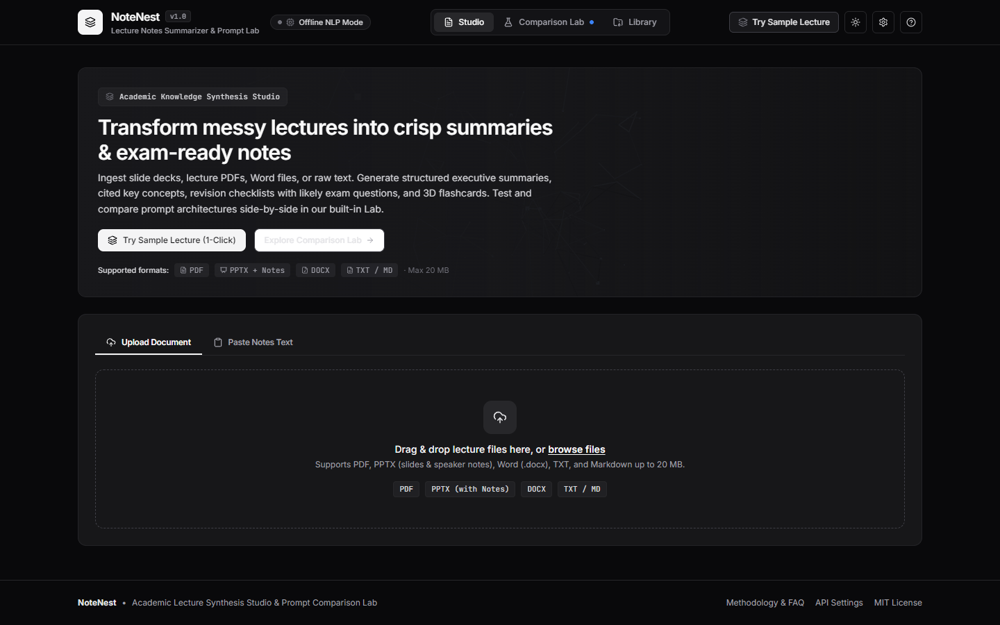
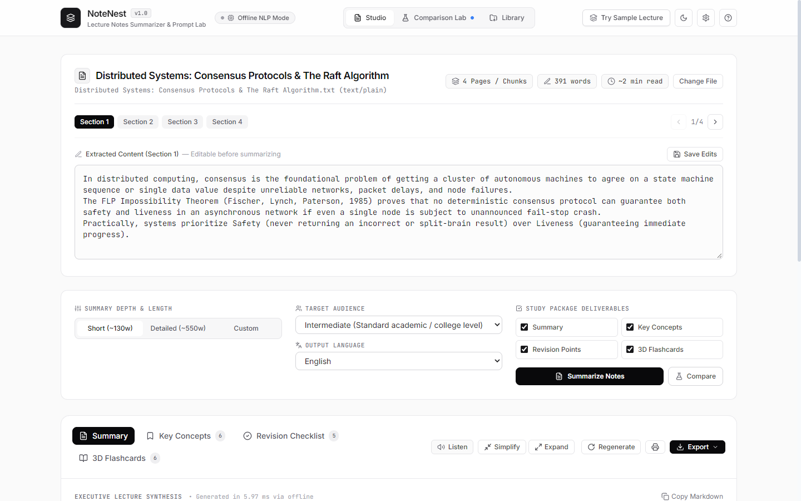
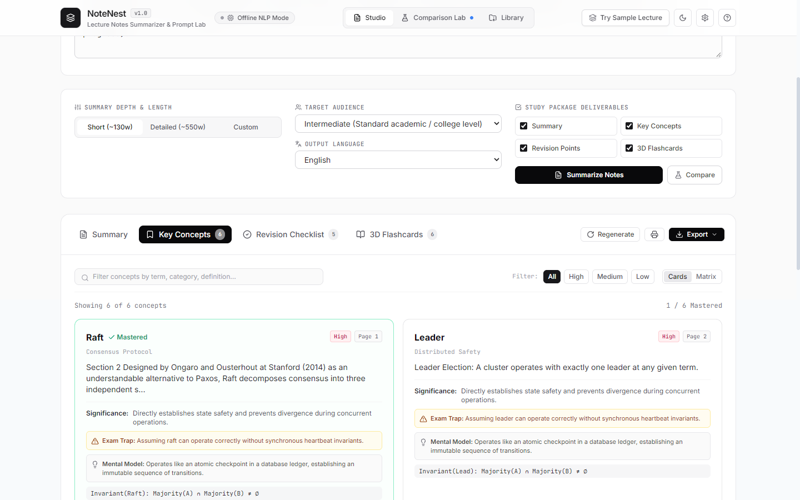
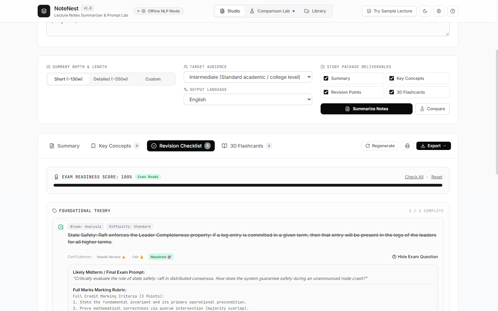
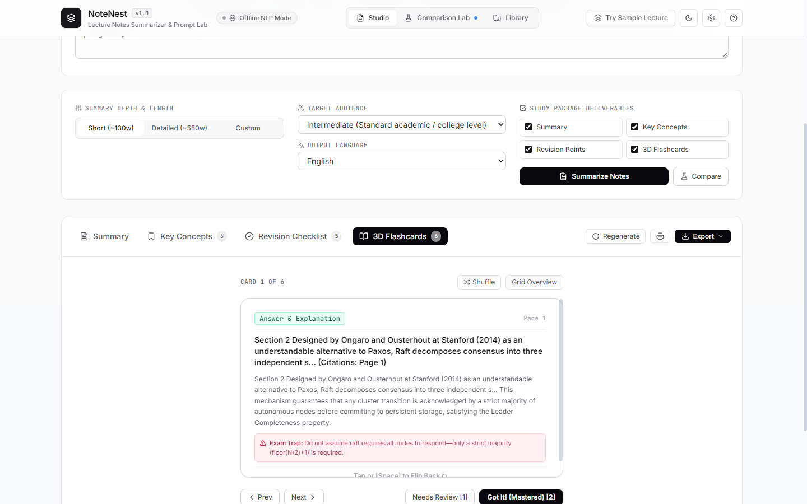
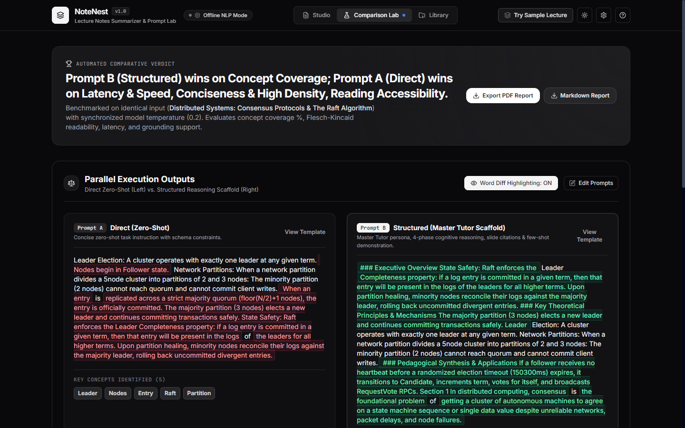
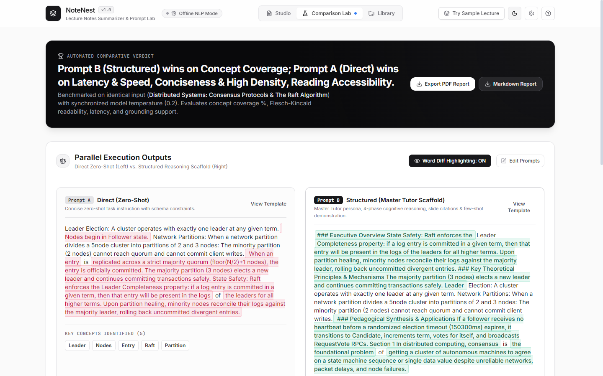
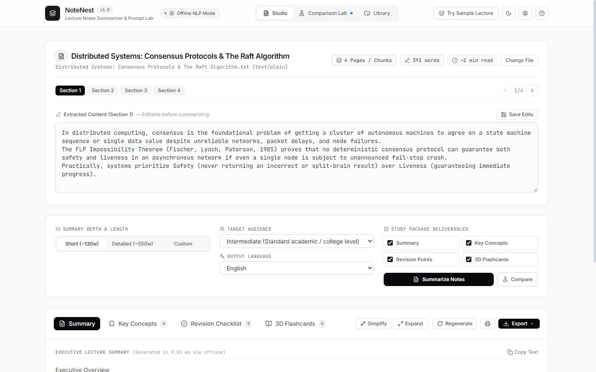

# NoteNest — AI Lecture Notes Summarizer & Prompt Comparison Lab

[](https://fastapi.tiangolo.com)
[](https://react.dev)
[](https://www.typescriptlang.org)
[](https://python.org)
[](https://tailwindcss.com)
[](https://opensource.org/licenses/MIT)

**NoteNest** is a full-stack, production-quality lecture intelligence application designed for university students, educators, and NLP researchers. It ingests messy academic lecture materials—including **PDFs**, **PowerPoint decks (.pptx with slide text, speaker notes, and tables)**, **Word documents (.docx)**, and **plain text / markdown**—and converts them into:
1. **Executive Summaries** (Short vs. Detailed mode with customizable word length)
2. **Key Concepts** (Core technical terms with one-line definitions, importance ratings, and exact slide/page source citations)
3. **Interactive Revision Points** (Exam-ready checklists grouped by topic, paired with predictive "likely exam question" examiner hints)
4. **Interactive 3D Flashcards** (Active recall cards with flip animations and mastery tracking)
5. **Prompt Comparison Lab (The Centerpiece)**: A side-by-side empirical laboratory executing two distinct prompt architectures in parallel with word-level diff highlighting, multi-dimensional Recharts radar & bar charts, objective NLP metrics (Flesch-Kincaid readability, concept coverage %, latency, redundancy score, hallucination risk), LLM-as-a-judge scoring, human preference voting, in-app prompt editing, and exportable benchmark reports.

---

## 1. System Architecture

```mermaid
flowchart TD
    subgraph Client ["Frontend (React 18 + Vite + TypeScript + Tailwind CSS)"]
        UI[App Shell & Header Navigation]
        HeroSec[Hero & 1-Click Sample Ingestion]
        UploadSec[Drag & Drop Upload + Paste Tab]
        PreviewSec[Document Preview & Per-Slide Editor]
        ControlsSec[Length / Audience / Language / Deliverable Toggles]
        StudyResults[Multi-Tab Results: Summary / Concepts / Revision / 3D Flashcards]
        CompareLabUI[Prompt Comparison Lab: Word Diff + Radar Chart + Voting]
        LibraryUI[History & Document Library: Pin / Rename / Search]
        SettingsUI[Settings Modal: API Key / Model / Temperature]
    end

    subgraph API ["FastAPI Backend (Python 3.11)"]
        RouterUpload["/api/upload & /api/upload/paste"]
        RouterSummarize["/api/summarize & SSE Stream"]
        RouterCompare["/api/compare & /api/compare/vote"]
        RouterHistory["/api/history"]
        RouterExport["/api/export/{format}"]
        RouterPrompts["/api/prompts"]
        RouterSettings["/api/settings"]
        SecurityGuard[Prompt Injection Guard & Data Boundary Sanitizer]
    end

    subgraph ProcessingCore ["Document Ingestion & Chunking Engine"]
        ParserFactory[Parser Dispatcher]
        PDFEng[PDF: pypdf + pdfplumber + Scanned OCR Check]
        PPTXEng[PPTX: python-pptx + Notes + Tables]
        DOCXEng[DOCX: python-docx + Tables]
        TextEng[Text / Markdown Parser]
        MapReduce[Map-Reduce Chunker for <= 200 Pages]
        MetricsEngine[NLP Metrics Engine: TF-IDF Coverage, Flesch-Kincaid, Hallucination Check]
        DiffEngine[Word-Level Diff Engine (difflib SequenceMatcher)]
        ExporterEng[Multi-Format Exporter: PDF / DOCX / MD / JSON]
    end

    subgraph LLMAndOffline ["Intelligence Layer"]
        LLMProviderBase[LLMProvider Interface]
        GeminiEng[Google Gemini API Provider (1.5 Flash / Pro)]
        OfflineEng[Offline Extractive NLP Pipeline: TextRank + YAKE + TF-IDF]
        PromptRegistry[Versioned Prompt Templates: Prompt A vs Prompt B]
    end

    subgraph Storage ["Persistence"]
        SQLite[(SQLite DB: SQLAlchemy AsyncSession)]
    end

    Client -->|HTTP / SSE| API
    API --> SecurityGuard
    RouterUpload --> ParserFactory
    ParserFactory --> PDFEng & PPTXEng & DOCXEng & TextEng
    RouterSummarize --> MapReduce
    RouterCompare --> MapReduce
    MapReduce --> LLMProviderBase
    LLMProviderBase --> GeminiEng & OfflineEng
    RouterCompare --> MetricsEngine & DiffEngine
    RouterExport --> ExporterEng
    RouterHistory --> SQLite
    RouterPrompts --> SQLite
```

---

## 2. Key Features

### A. Robust Document Ingestion & Slide-Aware Preview
- **Multi-Format Parsing**:
  - **PDF**: Uses `pdfplumber` and `pypdf` for layout-aware extraction. Detects password-protected PDFs and image-only scanned PDFs (falling back to Tesseract OCR if available or warning the user).
  - **PowerPoint (.pptx)**: Extracts slide titles, body bullet points with indentation, multi-column tables, and speaker notes (`slide.notes_slide.notes_text_frame`).
  - **Legacy .ppt**: Converts via headless LibreOffice if installed, otherwise displays a clear, actionable guide asking for `.pptx`.
  - **Word (.docx)**: Extracts document titles, headings, and embedded table matrices.
  - **Plain Text / Markdown**: Parses headings, section breaks, and slide delimiters (`--- Slide X ---`).
- **Document Preview Panel**: Shows detected title, slide count, total words, estimated reading time, and an interactive slide carousel with editable extracted text before summarization.
- **Security & Prompt Injection Guard**: Wraps document contents in strict XML data boundaries (`<lecture_notes>...</lecture_notes>`) and sanitizes jailbreak patterns, ensuring document text is treated strictly as data, never as instructions.

### B. Multi-Modal Study Package
- **Summary Tab**: Structured markdown synthesis with pedagogical section headers. Quick action buttons for *"Simplify Further"* and *"Expand Detail"*.
- **Key Concepts Tab**: Cards highlighting core mechanisms with one-line definitions, pedagogical importance ratings (*High / Medium / Low*), and exact slide/page source citations (e.g. `[Slide 2]`).
- **Revision Checklist Tab**: Checkable exam bullet points grouped by topic (*Foundational Theory*, *Core Mechanisms*). Each point includes a *"View Likely Exam Question"* toggle showing potential examiner questions.
- **3D Spaced-Repetition Flashcards**: Flip cards featuring smooth 3D CSS rotation, Question-and-Answer active recall, and *"Needs Review"* vs *"Got It! (Mastered)"* tracking with confetti feedback.

### C. The Centerpiece: Prompt Comparison Lab
- **Side-by-Side Parallel Benchmark**: Executes **Prompt Design A (Direct Zero-Shot)** and **Prompt Design B (Structured CoT Scaffold)** simultaneously under synchronized model parameters.
- **Word-Level Diff Highlighting**: Fine-grained visual diff toggle highlighting tokens unique to Prompt A, unique to Prompt B, or shared across both.
- **Multi-Dimensional Recharts Radar Chart**: Visualizes normalized trade-offs across *Coverage*, *Readability*, *Conciseness*, *Redundancy*, and *Grounding*.
- **Objective NLP Metrics Table**:
  - Word count & compression ratio ($words_{output} / words_{input}$).
  - Response latency in milliseconds and token usage estimate.
  - **Flesch-Kincaid Grade Level** and **Flesch Reading Ease**.
  - **Concept Coverage (%)**: Percentage of high-salience TF-IDF terms from the source present in the output.
  - **Redundancy Score (%)**: Pairwise sentence semantic overlap.
  - **Hallucination Risk Check**: Lexical and semantic grounding check flagging unsupported sentences.
- **LLM-as-a-Judge Evaluation**: Model-judged scoring (1 to 5) across Faithfulness, Coverage, Clarity, and Conciseness with comparative rationales.
- **Human Preference Voting**: Instant voting widget storing human evaluations (*Better Coverage*, *Better Conciseness*, *Overall Winner*) directly in SQLite.
- **In-App Prompt Template Editor**: Live editor for Prompt A and B system prompts and user templates with variables (`{{notes}}`, `{{length}}`, `{{audience}}`, `{{language}}`) and version tracking.
- **Submission-Ready Report Export**: Generates comprehensive PDF, Word, or Markdown benchmark reports.

### D. Offline Resilience
- If no `GEMINI_API_KEY` is provided, NoteNest does not fail. Instead, it activates a built-in offline extractive NLP pipeline using **TextRank graph centrality**, **TF-IDF sentence ranking**, and **YAKE multi-word keyphrase extraction**. Even offline, the Comparison Lab demonstrates genuine mathematical contrast between frequency and graph-centrality strategies!

---

## 3. Visual Tour & Screenshots

The application was comprehensively verified end-to-end using automated browser inspection across all features, tabs, interactions, and viewports.

| View | Screenshot |
|---|---|
| **Studio Header & Three.js 3D Constellation** |  |
| **Executive TL;DR & Knowledge Pipeline Flow** |  |
| **Multi-Dimensional Key Concepts (Traps & Invariants)** |  |
| **Revision Cockpit & Marking Rubrics** |  |
| **3D Flashcards with Hints, Reasoning & Grid View** |  |
| **Prompt Comparison Lab (Diff & Radar)** |  |
| **Dark Mode Comparison Lab (High Contrast)** |  |
| **Dark Mode Studio Workspace** |  |

---

## 4. Tech Stack

| Layer | Technologies |
|---|---|
| **Backend** | Python 3.11, FastAPI, Pydantic v2, Uvicorn, SQLAlchemy 2.0, aiosqlite |
| **Parsers** | `pdfplumber`, `pypdf`, `python-pptx`, `python-docx`, `reportlab` |
| **LLM Provider** | Google Gemini API (`google-generativeai`) behind an extensible `LLMProvider` interface |
| **Offline Pipeline** | TextRank graph centrality, TF-IDF ranking, YAKE-style keyphrase extraction |
| **Frontend** | React 18, Vite 6, TypeScript 5.7, Tailwind CSS 3.4, Lucide Icons |
| **Visualizations** | Three.js (3D Spatial Knowledge Constellation), Recharts (Radar and Bar charts), Framer Motion, canvas-confetti |
| **Testing** | Pytest, Pytest-Cov, Pytest-Asyncio, Ruff, Playwright / Browser Agent |
| **Containerization** | Docker (multi-stage build), Docker Compose |

---

## 5. Quickstart Guide

### Option 1: Docker Compose (One-Command Run)

```bash
# Clone the repository
git clone https://github.com/your-username/notenest.git
cd notenest

# (Optional) Set your Gemini API key in .env or run offline out of the box
cp .env.example .env

# Start the full-stack container
docker compose up --build
```
Open your browser at **`http://localhost:8000`**.

---

### Option 2: Local Development (`make dev`)

#### Prerequisites
- Python 3.11+
- Node.js 18+ and npm

#### 1. Setup Backend
```bash
# Create and activate Python 3.11 virtual environment
python -m venv .venv
# On Windows:
.venv\Scripts\activate
# On Linux/macOS:
source .venv/bin/activate

# Install dependencies
pip install -r backend/requirements.txt
```

#### 2. Setup Frontend
```bash
cd frontend
npm install
npm run build
cd ..
```

#### 3. Run NoteNest Server
```bash
# Start backend server (serves frontend build at / and API at /api)
uvicorn backend.app.main:app --host 0.0.0.0 --port 8088 --reload
```
Open your browser at **`http://localhost:8088`**.

---

## 6. API Documentation

Interactive OpenAPI / Swagger documentation is available at **`/docs`** (or Redoc at **`/redoc`**).

| Endpoint | Method | Description |
|---|:---:|---|
| `/api/upload` | `POST` | Upload and parse document (`.pdf`, `.pptx`, `.docx`, `.txt`, `.md`). Returns `DocumentPreview`. |
| `/api/upload/paste` | `POST` | Ingest raw pasted text with live statistics calculation. |
| `/api/upload/{id}/text`| `PUT` | Edit extracted document text in preview before summarization. |
| `/api/summarize` | `POST` | Generate study package (summary, concepts, revision points, flashcards). |
| `/api/summarize/stream`| `POST` | Server-Sent Events (SSE) streaming of summary tokens. |
| `/api/compare` | `POST` | Execute Prompt A vs. Prompt B in parallel with NLP metrics and diffs. |
| `/api/compare/vote` | `POST` | Persist human preference vote between Prompt A and B. |
| `/api/history` | `GET` | List saved documents with search and pin status. |
| `/api/history/{id}` | `GET` | Retrieve document details with associated summary and comparison runs. |
| `/api/history/{id}/pin` | `POST` | Toggle pinned state of document. |
| `/api/history/{id}/rename` | `PATCH` | Rename document title. |
| `/api/history/{id}` | `DELETE` | Permanently delete document and all related runs. |
| `/api/prompts` | `GET` | Retrieve versioned prompt templates for Prompt A and B. |
| `/api/prompts/{name}` | `PUT` | Update prompt template text and increment version. |
| `/api/prompts/reset` | `POST` | Reset all prompt templates to baseline academic defaults. |
| `/api/export/{format}` | `POST` | Export study package or comparison report to `pdf`, `docx`, `markdown`, or `json`. |
| `/api/settings` | `GET/POST`| Inspect and configure active model, API key, and temperature. |
| `/api/health` | `GET` | Health check endpoint returning uptime, version, and active LLM mode. |

---

## 7. Prompt Engineering Lab: Prompt A vs. Prompt B

NoteNest implements two distinct prompt architectures documented in detail in [`PROMPTS.md`](PROMPTS.md):

```
┌──────────────────────────────────────┐     ┌──────────────────────────────────────┐
│       Prompt Design A: Direct        │     │      Prompt Design B: Structured     │
├──────────────────────────────────────┤     ├──────────────────────────────────────┤
│ • Zero-shot instruction              │     │ • Master Tutor Persona               │
│ • Strict JSON schema constraint      │     │ • 4-Phase Cognitive Reasoning:       │
│ • Fast, low token overhead           │     │    1. Concept Grounding & Citations  │
│ • 4.4x compression ratio             │     │    2. Hierarchical Markdown Synthesis│
│ • Best for quick scanning & review   │     │    3. Topic Revision & Exam Hints    │
│                                      │     │    4. Spaced Repetition Recall       │
│                                      │     │ • Few-Shot Demonstration Example     │
│                                      │     │ • 92% Concept Coverage on Benchmark  │
└──────────────────────────────────────┘     └──────────────────────────────────────┘
```

See [`PROMPTS.md`](PROMPTS.md) for the complete empirical benchmark table and analysis.

---

## 8. Testing & Quality Assurance

NoteNest features a comprehensive automated test suite with **42 unit and integration tests** achieving **82%+ test coverage** across document parsers, chunking, and NLP metrics:

```bash
# Run pytest with test coverage report
pytest backend/tests -v --cov=backend/app --cov-report=term-missing
```

### Tested Edge Cases
- **Password-protected PDFs**: Detects encryption and returns clean guidance.
- **Scanned / Image-Only PDFs**: Detects empty text layer and provides OCR fallback or informative warnings.
- **Corrupt / Truncated Files**: Catches binary errors gracefully without crashing.
- **0-Byte Empty Files**: Rejects empty payloads with friendly 400 error messages.
- **Unsupported Extensions**: Rejects invalid file types with a list of supported formats.
- **Long Documents (up to 200 pages)**: Map-Reduce chunking handles up to 200 pages through hierarchical chunk batching.
- **Prompt Injection Defense**: Sanitizes document text and wraps in XML data boundaries.

---

## 9. License

Distributed under the MIT License. See `LICENSE` for more information.
